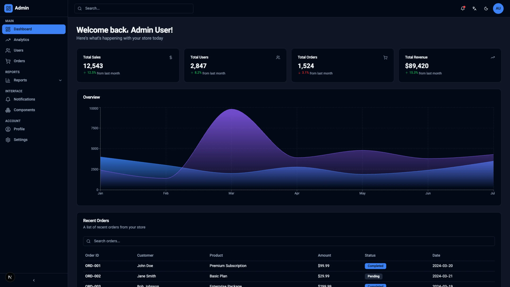

# Modern Admin Dashboard Template

A beautiful, modern admin dashboard built with **Next.js 15**, **TypeScript**, **Tailwind CSS**, and **shadcn/ui**. Features a clean design with dark/light mode support, responsive layout, and comprehensive dashboard components.

> This template is designed and developed under the **Darvix** brand.  
> Website: [`https://darvix.ir/`](https://darvix.ir/)

## 🖼️ Demo Preview

### **🌐 Live Demo: [https://admin.darvix.ir/login](https://admin.darvix.ir/login)**



The demo screenshot showcases the main dashboard, analytics, notifications, profile, and components showcase pages.

## 🚀 Features

- ✅ **Next.js 15** with App Router
- ✅ **TypeScript** for type safety
- ✅ **Tailwind CSS** for styling
- ✅ **shadcn/ui** components
- ✅ **Dark/Light mode** with theme toggle
- ✅ **React Query** for data fetching
- ✅ **Responsive design** (mobile-friendly)
- ✅ **Admin authentication** with MySQL-backed sessions and operator-created accounts
- ✅ **Dashboard with analytics**
- ✅ **Player management** with search, status filters, pagination, details and suspension
- ✅ **Game management** with provider/category filters, portal visibility and category editing
- ✅ **Charts** powered by Recharts
- ✅ **Settings page** with form inputs
- ✅ **English-only interface** with shared labels in `src/locales/en.ts`
- ✅ **Left-to-right layout** on desktop and mobile, using the Inter font
- ✅ **Consistent language** across auth pages and the dashboard, independent of saved browser preferences
- ✅ **ESLint & Prettier** configured
- ✅ **Mock data** for development

## 📦 Tech Stack

- **Framework:** Next.js 15
- **Language:** TypeScript
- **Styling:** Tailwind CSS
- **UI Components:** shadcn/ui
- **Icons:** Lucide React
- **Charts:** Recharts
- **Data Fetching:** TanStack Query (React Query)
- **Theme Management:** next-themes
- **Code Quality:** ESLint + Prettier

## 🗂️ Project Structure

```
admin-dashboard-next/
├── src/
│   ├── app/
│   │   ├── (auth)/
│   │   │   ├── login/
│   │   │   │   └── page.tsx
│   │   │   ├── register/
│   │   │   │   └── page.tsx
│   │   │   └── layout.tsx
│   │   ├── (dashboard)/
│   │   │   ├── dashboard/
│   │   │   │   └── page.tsx
│   │   │   ├── users/
│   │   │   │   └── page.tsx
│   │   │   ├── orders/
│   │   │   │   └── page.tsx
│   │   │   ├── reports/
│   │   │   │   └── page.tsx
│   │   │   ├── settings/
│   │   │   │   └── page.tsx
│   │   │   └── layout.tsx
│   │   ├── globals.css
│   │   ├── layout.tsx
│   │   └── page.tsx
│   ├── components/
│   │   ├── ui/
│   │   │   ├── button.tsx
│   │   │   ├── card.tsx
│   │   │   ├── input.tsx
│   │   │   ├── table.tsx
│   │   │   └── ... (more UI components)
│   │   ├── layout/
│   │   │   ├── sidebar.tsx
│   │   │   └── navbar.tsx
│   │   └── dashboard/
│   │       ├── stat-card.tsx
│   │       ├── overview-chart.tsx
│   │       └── recent-orders.tsx
│   ├── lib/
│   │   ├── utils.ts
│   │   ├── api.ts
│   │   └── auth.ts
│   ├── hooks/
│   │   └── use-theme.tsx
│   ├── providers/
│   │   ├── query-provider.tsx
│   │   └── theme-provider.tsx
│   ├── types/
│   │   └── index.ts
│   └── data/
│       ├── mock-users.json
│       ├── mock-orders.json
│       ├── mock-stats.json
│       └── mock-chart.json
├── public/
├── tailwind.config.ts
├── tsconfig.json
├── next.config.ts
├── components.json
├── .prettierrc.json
└── package.json
```

## 🛠️ Installation & Setup

### Prerequisites

- Node.js 18+ and npm/yarn/pnpm

### Clone and Install

```bash
# Navigate to project directory
cd admin-dashboard-next

# Install dependencies
npm install
```

### Run Development Server

```bash
npm run dev
```

Open [http://localhost:3001](http://localhost:3001) in your browser. Configure and start the admin backend on port 4001 first, as described below.

## 📱 Pages Overview

### Authentication

- **Login (`/login`)**: Administrator authentication
- **Register (`/register`)**: Redirects to login; administrator accounts are created by an operator

### Dashboard Pages

- **Dashboard (`/dashboard`)**: Main dashboard with stats, charts, and recent orders
- **Users (`/users`)**: Database-backed player search, status filtering, pagination, details, display-name editing and suspend/reactivate controls
- **Games (`/games`)**: Imported provider catalog with search, filters, category editing, show/hide controls and import status
- **Orders (`/orders`)**: Simple orders table with status badges for each order
- **Reports (`/reports`)**: Analytics and detailed reports
- **Settings (`/settings`)**: User preferences and account settings
- **Analytics (`/analytics`)**: Detailed analytics with metrics cards, traffic sources, top pages, and overview/engagement/conversion tabs
- **Notifications (`/notifications`)**: Notification center with unread/read tabs, mark‑all‑as‑read, and inline actions
- **Profile (`/profile`)**: Read-only details from the authenticated administrator account
- **Components Showcase (`/components-demo`)**: Full gallery of all UI components (buttons, badges, inputs, select, switch, alerts, progress, avatar, skeleton, cards, table, tabs, dialog, dropdown, combined example, color palette)

## 🎨 Features Breakdown

### Dashboard Page

- 4 statistic cards (Sales, Users, Orders, Revenue)
- Interactive area chart showing trends
- Recent orders table with search functionality

### Users Page

- Search by display name, email or player ID
- Filter active/suspended accounts with server pagination
- View account details and active sessions
- Edit display name; suspend/reactivate accounts
- Suspension revokes player sessions; mutations are recorded in the admin audit log

### Games Page

- Browse the real imported catalog for the backend's configured currency
- Search and filter by provider, category, provider availability and portal visibility
- Edit reviewed categories, including Featured and New Games
- Hide/show games without changing provider metadata or losing settings during imports
- View import status; Refresh reloads the database list (provider sync runs in the player backend)

### Settings Page

- Profile information form
- Theme selection (Light/Dark/System)
- Notification preferences

## 🎯 Scripts

```bash
# Development
npm run dev

# Build for production
npm run build

# Start production server
npm start

# Lint code
npm run lint

# Format code with Prettier
npm run format

# Check formatting
npm run format:check
```

## 🌈 Theme Support

The dashboard supports three theme modes:

- **Light Mode**
- **Dark Mode**
- **System** (follows OS preference)

Toggle theme using the button in the top navbar.

## 🔐 Authentication

Authentication uses the separate `../choicestakes-adminback` Node.js backend and its MySQL `admins` table. Follow that project's README to configure MySQL, run migrations, and create your first administrator with `npm run admin:create`.

Copy `.env.example` to `.env.local` and set the server-only `ADMIN_BACKEND_INTERNAL_URL` (default `http://127.0.0.1:4001`). Add the exact frontend origin to the backend's `ADMIN_ORIGINS`. Use HTTPS and `NODE_ENV=production` when deploying the backend.

The browser calls same-origin `/api/admin/auth/login`, `/me`, and `/logout` routes. Session cookies are HttpOnly and are verified by the backend before dashboard pages render. Old localStorage mock-login values no longer grant access. Sign-out revokes the stored session; there is no public administrator registration.

Profile details are read from the authenticated account. Password resets use the backend's operator-only `admin:reset-password` command. Users and Games call authenticated `/api/admin/manage/*` proxies. Other template modules such as dashboard statistics, orders and analytics still use mock data.

Before using management, apply the player backend migrations through `005_game_visibility`
and the admin backend migrations through `002_admin_management`. Both APIs must use the
same MySQL database and `APIMATIC_CURRENCY`. Follow the admin backend README's deployment
order and runtime database grants. Missing database access shows a retryable error;
these pages never fall back to sample records.

## 📊 Mock Data

Mock data is located in `src/data/`:

- `mock-users.json`: Legacy template data (not used by User management)
- `mock-orders.json`: Order data
- `mock-stats.json`: Dashboard statistics
- `mock-chart.json`: Chart data

Replace with real API calls in `src/lib/api.ts` for production.

## 🚀 Deployment

### Vercel (Recommended)

1. Push your code to GitHub
2. Import project in [Vercel](https://vercel.com)
3. Deploy with one click

### Build & Deploy Manually

```bash
npm run build
npm start
```

## 🎨 Customization

### Colors

Edit `src/app/globals.css` to customize the color palette.

### Components

All UI components are in `src/components/ui/` and can be customized.

### Navigation

Edit sidebar navigation in `src/components/layout/sidebar.tsx`.

## 📝 Environment Variables

Create a `.env.local` file for environment variables:

```env
# Server-only address of the admin backend
ADMIN_BACKEND_INTERNAL_URL=http://127.0.0.1:4001
```

## 🤝 Contributing

Contributions are welcome! Please feel free to submit a Pull Request.

## 📄 License

This project is open source and available under the MIT License.

## 🙏 Acknowledgments

- [Next.js](https://nextjs.org/)
- [shadcn/ui](https://ui.shadcn.com/)
- [Tailwind CSS](https://tailwindcss.com/)
- [Lucide Icons](https://lucide.dev/)
- [Recharts](https://recharts.org/)

---

**Built with ❤️ using Next.js 15 — by [Darvix](https://darvix.ir/)**  
Darvix: توسعه وب، طراحی UI/UX و محصولات دیجیتال مدرن با تکنولوژی‌های روز.  
وب‌سایت: [`https://darvix.ir/`](https://darvix.ir/)
